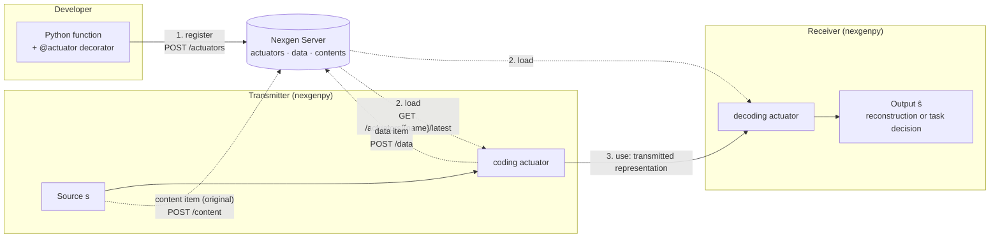

<div align="center">

# nexgenpy

**The Python client for Nexgen Server. Publish, load and run semantic communication actuators.**

[](https://github.com/iamalreadynoob/nexgen/actions/workflows/ci.yml)
[](https://www.python.org/downloads/)
[](pyproject.toml)
[](https://github.com/iamalreadynoob/nexgen-server)
[](https://github.com/astral-sh/ruff)
[](https://github.com/astral-sh/uv)
[](.pre-commit-config.yaml)

<p>
  <a href="#introduction">Introduction</a> •
  <a href="#setup">Setup</a> •
  <a href="#basic-concepts">Basic concepts</a> •
  <a href="#documentation">Documentation</a>
</p>

</div>

---

## Introduction

`nexgenpy` is the Python client library for [Nexgen Server](https://github.com/iamalreadynoob/nexgen-server). Nexgen Server is a registry and data store for semantic communication (SemCom) applications.

SemCom is a communication paradigm. Its design objective is the correct delivery of the *meaning*, or of the *task-relevant content*, of a message. Its objective is not the bit-exact copy of the transmitted symbols. Thus the methods at each end of the link are as important as the link itself.

Nexgen Server keeps these methods, called **actuators**, in one place. The server does not run actuator code. `nexgenpy` gives the applications three operations:

| Operation | API | What it does |
|---|---|---|
| **Register** | `@actuator(...)` | Sends the source code of a Python function to the server as a new actuator version. |
| **Load** | `load_actuator(...)` | Downloads the latest version of an actuator to a local directory and installs its requirements. |
| **Use** | `run_actuator(...)`, `Actuator(...)` | Runs the local actuator. Optionally sends the output to the server as a data item. |



1. A developer writes a Python function and registers it as an actuator with a name and a version.
2. A transmitter and a receiver each load the latest version of the actuators that they need.
3. Each side runs its actuator on local data. The output can go to the server as a data item. The original input can go to the server as a content item.

`nexgenpy` supports the two SemCom objectives of Nexgen Server:

- **Semantic-level communication.** The decoding actuator recreates the source, or its meaning, from the received representation.
- **Goal-oriented (task-oriented) communication.** The decoding actuator identifies the input or does a task with it, for example classification. It does not recreate the source.

## Setup

### Requirements

- Python 3.12 or later
- A running [Nexgen Server](https://github.com/iamalreadynoob/nexgen-server#setup)
- The API key of the server, if the server has one

### Install the library

Install from GitHub with pip:

```bash
pip install "git+https://github.com/iamalreadynoob/nexgen.git"
```

Or add it to a uv project:

```bash
uv add "git+https://github.com/iamalreadynoob/nexgen.git"
```

The repository also keeps a built wheel in `dist/`. To install a local clone for development, see [Development](docs/development.md).

### Connect to the server

Set these environment variables:

```bash
export NEXGEN_BASE_URL="http://localhost:8000/api/v1"
export NEXGEN_API_KEY="<your-key>"
```

If `NEXGEN_BASE_URL` is not set, the library uses `http://localhost:8000/api/v1`. See [Configuration](docs/configuration.md) for all settings.

### Register a first actuator

```python
from nexgenpy import actuator


@actuator(
    name="text-embedder",
    atype="coding",
    version="1.0.0",
    is_latest=True,
    requirements=["numpy"],
)
def encode(text: str) -> list[float]:
    import numpy as np

    return np.frombuffer(text.encode(), dtype=np.uint8).astype(float).tolist()


accepted = encode()  # sends POST /actuators, returns True or False
```

A call to the decorated function does not run `encode`. The call registers it.

### Load and use the actuator

```python
from nexgenpy import load_actuator, run_actuator

load_actuator("text-embedder")

vector = run_actuator(
    name="text-embedder",
    data={"text": "hello"},
)
```

`run_actuator` runs the function in the current Python process. Thus the current environment must also have the requirements of the actuator, `numpy` in this example. See [Architecture](docs/architecture.md#the-actuator-environment).

To send the output to the server as a data item, give the server URL and the API key header:

```python
vector = run_actuator(
    name="text-embedder",
    data={"text": "hello"},
    dst="http://localhost:8000/api/v1",
    dst_headers={"X-API-Key": "<your-key>"},
)
```

The [Quick start guide](docs/quickstart.md) gives a full transmitter and receiver example.

## Basic concepts

| Concept | What it is | Where it lives |
|---|---|---|
| **Actuator** | A versioned, named Python function that processes data. Its type is `coding` or `decoding`. | Server: `actuators` collection. Client: `nexgen_actuators/{name}/` |
| **Data** | The output of an actuator, as the link carries or uses it. Each data item refers to the actuator that made it. | Server: `data` collection |
| **Content** | The original input of an actuator. Applications can load it again, for example to compare it with a reconstruction. | Server: `contents` collection |

### Actuators

An actuator does one processing step in a SemCom pipeline. Examples are data embedding, compression and format conversion.

- A **`coding`** actuator changes a source into a representation for transmission. It can be a semantic encoder, a channel encoder or a joint source–channel coding (JSCC) encoder.
- A **`decoding`** actuator changes a received representation into an output. The output is a reconstruction of the source or a task decision.

Each actuator has a `name` and a `version`. For each name, exactly one active version is the latest. `load_actuator` always gets the latest version. Thus the transmitter and the receiver can use the same version.

### The actuator function

The server stores only the source code of the function. The code that is outside the function does not go to the server. Thus an actuator function must obey these rules:

- Put all `import` statements in the function body.
- Do not call helper functions from the same module. Define them in the function body.
- Use parameter names that match the keys of the input data. `run_actuator` calls the function with `**data`.
- Return a value that JSON can encode, if you send the output to the server.

[Writing actuators](docs/writing-actuators.md) explains each rule.

### Local actuator directory

`load_actuator` writes each actuator to `nexgen_actuators/{name}/`:

```text
nexgen_actuators/
└── text-embedder/
    ├── card.json          # metadata, including the server id and the version
    ├── method.py          # the source code of the function
    ├── requirements.txt   # the pip requirements
    └── .venv/             # a virtual environment with the requirements
```

### Shared rules

- All requests go to `NEXGEN_BASE_URL`, or to `dst` for data and content items.
- The library sends the `X-API-KEY` header when `NEXGEN_API_KEY` is set. Data and content requests use `dst_headers` instead.
- The server accepts a data item only from the **latest** version of an actuator. Load the actuator again after someone publishes a new version.

[Concepts](docs/concepts.md) gives more detail about SemCom and about how `nexgenpy` fits a SemCom pipeline.

## Documentation

| Document | Contents |
|---|---|
| [Quick start](docs/quickstart.md) | A full example: register, load and run a coding and a decoding actuator |
| [Concepts](docs/concepts.md) | SemCom background, the two objectives, and how actuators, data and contents fit a SemCom pipeline |
| [Architecture](docs/architecture.md) | Modules, the request flow for each operation and the local directory layout |
| [Writing actuators](docs/writing-actuators.md) | Rules and examples for actuator functions |
| [Configuration](docs/configuration.md) | Environment variables, API key, timeouts and logging |
| [API: `actuator`](docs/api/actuator.md) | The decorator that registers an actuator |
| [API: `load_actuator`](docs/api/load-actuator.md) | The function that downloads an actuator and installs its requirements |
| [API: `run_actuator` and `Actuator`](docs/api/run-actuator.md) | The function and the class that run an actuator and send its output |
| [Development](docs/development.md) | Tests, lint, CI, release and code conventions |
| [Security](docs/security.md) | Risks of downloaded actuator code, and SemCom threats |
| [Glossary](docs/glossary.md) | SemCom and project terms |
| [References](docs/references.md) | Surveys and papers about SemCom |
