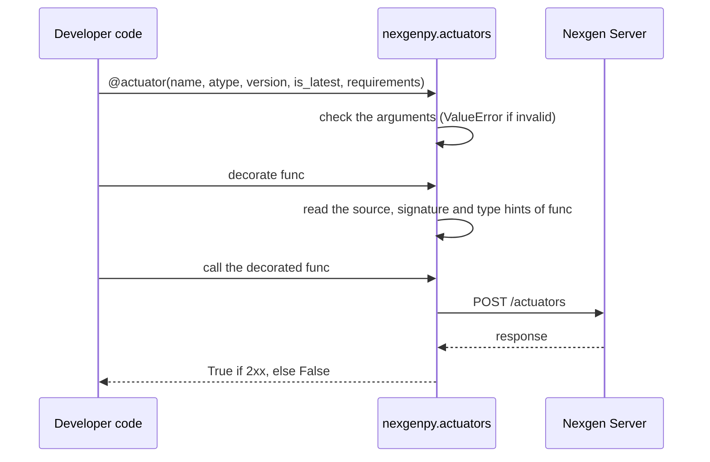
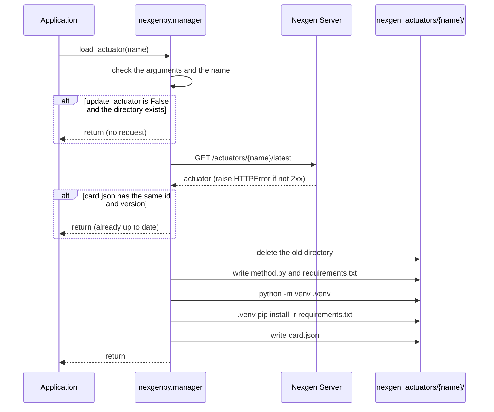
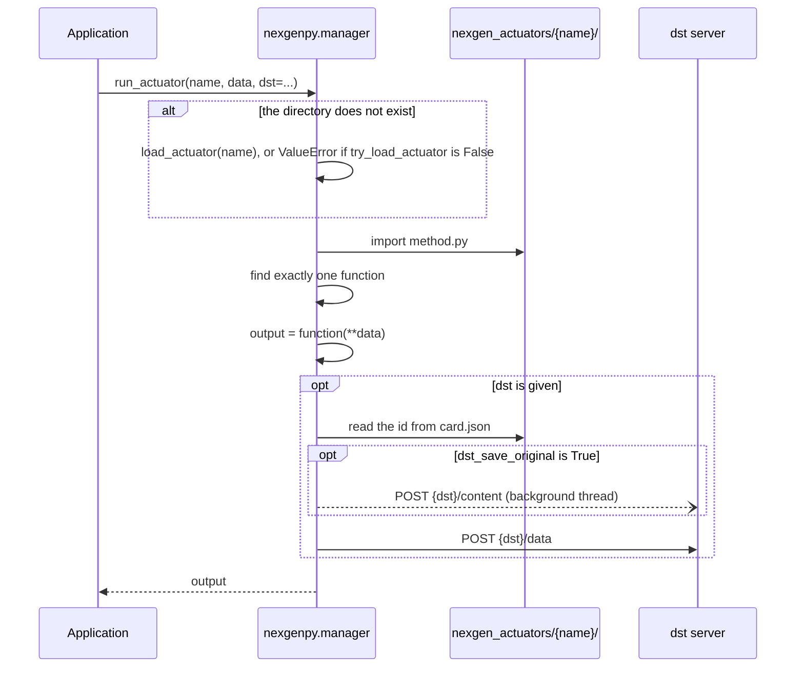

# nexgenpy API reference

Contents: `actuator` · `load_actuator` · `run_actuator` and `Actuator` · request flows · local layout and `card.json` · error behavior summary

## API: `actuator`

```python
from nexgenpy import actuator
```

### Signature

```python
def actuator(
    name: str,
    atype: Literal["coding", "decoding"],
    version: str,
    is_latest: bool,
    requirements: List[str] | None,
) -> Callable[[Callable[..., Any]], Callable[..., bool]]
```

A decorator that registers a function as an actuator on Nexgen Server.

### Parameters

All parameters are required. They have no default values.

| Parameter | Type | Description |
|---|---|---|
| `name` | `str` | The name of the actuator. |
| `atype` | `"coding"` or `"decoding"` | The type of the actuator. |
| `version` | `str` | The version of the actuator, for example `"1.0.0"`. |
| `is_latest` | `bool` | If `True`, the server marks this version as the latest version of `name`. |
| `requirements` | `List[str]` or `None` | The pip requirements of the actuator. `None` sends `[]`. |

### Returns

A decorator. The decorator returns a new function with the name and the docstring of the original function.

When the code calls the new function:

1. It sends `POST {NEXGEN_BASE_URL}/actuators`.
2. It returns `True` if the server returns a 2xx status.
3. It returns `False` if the request fails or the server returns a different status.

The new function accepts any arguments and ignores them. It does not run the original function.

### Raises

| Exception | Condition |
|---|---|
| `ValueError` | `name` or `version` is not a `str`. |
| `ValueError` | `atype` is not `"coding"` or `"decoding"`. |
| `ValueError` | `is_latest` is not a `bool`. |
| `ValueError` | `requirements` is not `None` and not a list of `str`. |

The decorator raises these errors when Python applies it, before any request.

The decorator also calls `inspect.getsource` and `typing.get_type_hints` on the function. These calls can raise `OSError` or `NameError`, for example for a function without a source file.

The decorated function does not raise for network errors. It logs a warning and returns `False`.

### Request

`POST {NEXGEN_BASE_URL}/actuators`

| Header | Value |
|---|---|
| `X-API-KEY` | `NEXGEN_API_KEY`, only if it is set |

Body:

```json
{
    "name": "keyword-extractor",
    "version": "1.0.0",
    "actuator_type": "coding",
    "set_latest": true,
    "requirements": [],
    "method": "def extract(text: str, max_words: int = 5) -> dict:\n    ...",
    "method_args": {
        "text": {"type": "<class 'str'>", "default": null},
        "max_words": {"type": "<class 'int'>", "default": "5"}
    }
}
```

`method` starts at the `def` line. The decorator lines are not in it.

### Example

```python
from nexgenpy import actuator


@actuator(
    name="keyword-extractor",
    atype="coding",
    version="1.0.0",
    is_latest=True,
    requirements=None,
)
def extract(text: str, max_words: int = 5) -> dict:
    import re

    words = re.findall(r"[a-z]+", text.lower())
    return {"keywords": words[:max_words]}


if extract() is False:
    raise SystemExit("The server did not accept the actuator")
```


## API: `load_actuator`

```python
from nexgenpy import load_actuator
```

### Signature

```python
def load_actuator(
    name: str,
    actuators_dir: str = "nexgen_actuators",
    load_timeout: int = 60,
    update_actuator: bool = True,
) -> None
```

Downloads the latest version of an actuator from Nexgen Server. It writes the actuator to `{actuators_dir}/{name}/` and installs its requirements.

### Parameters

| Parameter | Type | Default | Description |
|---|---|---|---|
| `name` | `str` | required | The name of the actuator. It must be a plain directory name. |
| `actuators_dir` | `str` | `"nexgen_actuators"` | The directory for the local actuators. |
| `load_timeout` | `int` | `60` | The timeout in seconds for the `GET` request. |
| `update_actuator` | `bool` | `True` | If `True`, the function asks the server for the latest version, also when a local copy exists. If `False` and a local copy exists, the function does nothing. |

### Returns

`None`.

### Steps

1. Check the arguments.
2. If `update_actuator` is `False` and `{actuators_dir}/{name}` exists, stop.
3. Send `GET {NEXGEN_BASE_URL}/actuators/{name}/latest`.
4. If the local `card.json` has the same `id` and `version` as the response, stop.
5. Delete the old `{actuators_dir}/{name}` directory, if it exists.
6. Write `method.py` and `requirements.txt`.
7. Make a virtual environment in `{actuators_dir}/{name}/.venv`.
8. Install `requirements.txt` with the `pip` of that environment.
9. Write `card.json`.

The function writes `card.json` last. If step 7 or step 8 fails, the next call downloads the actuator again.

### Raises

| Exception | Condition |
|---|---|
| `ValueError` | An argument has a wrong type. |
| `ValueError` | `name` is not a plain directory name, for example `"../other"` or `"a/b"`. |
| `requests.HTTPError` | The server returns a status that is not 2xx, for example 404 for an unknown name. |
| `requests.RequestException` | The request cannot connect or times out. |
| `subprocess.CalledProcessError` | The venv step or the pip step fails. |

### Request

`GET {NEXGEN_BASE_URL}/actuators/{name}/latest`

| Header | Value |
|---|---|
| `X-API-KEY` | `NEXGEN_API_KEY`, only if it is set |

The function uses these fields of the response: `id`, `name`, `version`, `actuator_type`, `method_args`, `latest`, `created_at`, `updated_at`, `requirements` and `method`.

### Files

| File | Content |
|---|---|
| `card.json` | `id`, `name`, `version`, `actuator_type`, `method_args`, `latest`, `created_at`, `updated_at` |
| `method.py` | The `method` field |
| `requirements.txt` | The `requirements` field, one item on each line |
| `.venv/` | A virtual environment with the requirements |

### Examples

Download or update an actuator:

```python
from nexgenpy import load_actuator

load_actuator("keyword-extractor")
```

Download an actuator only if no local copy exists:

```python
load_actuator("keyword-extractor", update_actuator=False)
```

Use a different directory and a shorter timeout:

```python
load_actuator(
    "keyword-extractor",
    actuators_dir="/opt/nexgen/actuators",
    load_timeout=10,
)
```

### Notes

- The pip step can take a long time for large requirements, for example `torch`. It has no timeout.
- `run_actuator` and `Actuator` do not use the `.venv`. See [Architecture](#the-actuator-environment).
- `load_actuator` runs `pip install` with requirements from the server. Use only a server that you trust. See [Security](security.md).


## API: `run_actuator` and `Actuator`

```python
from nexgenpy import Actuator, run_actuator
```

Use `run_actuator` for one call. Use the `Actuator` class for many calls, or in `async` code. The class imports `method.py` one time. `run_actuator` imports it on each call.

### `run_actuator`

#### Signature

```python
def run_actuator(
    name: str,
    data: Dict[str, Any],
    data_specs: Dict[str, Any] | None = None,
    actuators_dir: str = "nexgen_actuators",
    dst: str | None = None,
    dst_timeout: int = 60,
    dst_headers: Dict[str, Any] | None = None,
    dst_save_original: bool = True,
    try_load_actuator: bool = True,
) -> object
```

Runs a local actuator with `data`. If `dst` is given, it also sends the output to the `dst` server.

#### Parameters

| Parameter | Type | Default | Description |
|---|---|---|---|
| `name` | `str` | required | The name of the actuator. |
| `data` | `Dict[str, Any]` | required | The input of the actuator. The function gets it as `**data`. |
| `data_specs` | `Dict[str, Any]` or `None` | `None` | Free-form information about the data. It goes to the `specs` field of the data item. |
| `actuators_dir` | `str` | `"nexgen_actuators"` | The directory for the local actuators. |
| `dst` | `str` or `None` | `None` | The root URL of the server that stores the output, for example `http://localhost:8000/api/v1`. If `None`, the function sends nothing. |
| `dst_timeout` | `int` | `60` | The timeout in seconds for each `dst` request. |
| `dst_headers` | `Dict[str, Any]` or `None` | `None` | The headers for each `dst` request, for example `{"X-API-Key": "..."}`. |
| `dst_save_original` | `bool` | `True` | If `True` and `dst` is given, the function also sends `data` as a content item. |
| `try_load_actuator` | `bool` | `True` | If `True` and the actuator is not local, the function calls `load_actuator` first. If `False`, it raises `ValueError`. |

#### Returns

The return value of the actuator function.

#### Steps

1. Check the arguments.
2. If `{actuators_dir}/{name}` does not exist, call `load_actuator(name, actuators_dir)` or raise `ValueError`.
3. Import `{actuators_dir}/{name}/method.py`.
4. Find the one function in `method.py`.
5. Call the function with `**data`.
6. If `dst` is `None`, return the output.
7. Read `id` from `card.json`.
8. If `dst_save_original` is `True`, make a random UUID. Send the content item in a background thread.
9. Send the data item.
10. Return the output.

`run_actuator` does not update a local actuator that exists. To get a new version, call `load_actuator` first.

#### Raises

| Exception | Condition |
|---|---|
| `ValueError` | An argument has a wrong type. |
| `ValueError` | The actuator is not local and `try_load_actuator` is `False`. |
| `ValueError` | `method.py` does not define exactly one function. |
| `ImportError` | Python cannot load `method.py`. |
| Any exception | The actuator function raises it. |
| `requests.RequestException` | `POST {dst}/data` cannot connect or times out. |

`run_actuator` can also raise the exceptions of `load_actuator` (see its Raises table above) when it loads the actuator.

If `POST {dst}/data` returns a status that is not 2xx, the function logs a warning and returns the output. It does not raise.

#### Requests

The requests go only to `dst`. They use `dst_headers`, not `NEXGEN_API_KEY`.

`POST {dst}/data`:

```json
{
    "actuator_id": "<id from card.json>",
    "metadata": "<output of the actuator>",
    "linked_resource": "<UUID, or null if dst_save_original is False>",
    "specs": "<data_specs, or null>"
}
```

`POST {dst}/content`, only if `dst_save_original` is `True`:

```json
{
    "identifier": "<the same UUID as linked_resource>",
    "specs": "<data>"
}
```

The content request runs in a background thread. The function does not wait for it. If the request fails, the thread logs a warning.

#### Examples

Run an actuator locally:

```python
from nexgenpy import run_actuator

output = run_actuator(name="keyword-extractor", data={"text": "rain in the north"})
```

Run an actuator and store the output and the original input:

```python
import os

output = run_actuator(
    name="keyword-extractor",
    data={"text": "rain in the north"},
    data_specs={"language": "en", "source": "sensor-12"},
    dst=os.environ["NEXGEN_BASE_URL"],
    dst_headers={"X-API-Key": os.environ["NEXGEN_API_KEY"]},
)
```

Run an actuator only if it is already local:

```python
output = run_actuator(
    name="keyword-extractor",
    data={"text": "rain in the north"},
    try_load_actuator=False,
)
```

### `Actuator`

#### Constructor

```python
class Actuator:
    def __init__(
        self,
        name: str,
        actuators_dir: str = "nexgen_actuators",
        dst: str | None = None,
        dst_timeout: int = 60,
        dst_headers: Dict[str, Any] | None = None,
        dst_save_original: bool = True,
        try_load_actuator: bool = True,
    ) -> None
```

The parameters have the same meaning as in `run_actuator` (see its Parameters table above). The constructor does steps 1 to 4 of `run_actuator` one time. If `dst` is given, it also reads `id` from `card.json`.

The constructor raises the same exceptions as `run_actuator`, except the exceptions of the actuator function and of `POST {dst}/data`.

#### Attributes

| Attribute | Type | Description |
|---|---|---|
| `name` | `str` | The name of the actuator. |
| `actuators_dir` | `str` | The directory for the local actuators. |
| `dst` | `str` or `None` | The root URL of the `dst` server. |
| `dst_timeout` | `int` | The timeout for each `dst` request. |
| `dst_headers` | `Dict[str, Any]` | The headers for each `dst` request. `{}` if `None` was given. |
| `dst_save_original` | `bool` | If `True`, each run also sends a content item. |
| `actuator_id` | `str` or `None` | The server `id` of the actuator. `None` if `dst` is `None`. |
| `method` | `Callable[..., Any]` | The function from `method.py`. |

#### `run`

```python
def run(
    self,
    data: Dict[str, Any],
    data_specs: Dict[str, Any] | None = None,
) -> object
```

Runs the loaded function with `**data`. It does steps 5 to 10 of `run_actuator`. It returns the output.

#### `arun`

```python
async def arun(
    self,
    data: Dict[str, Any],
    data_specs: Dict[str, Any] | None = None,
) -> object
```

The `async` version of `run`. It runs the function and `POST {dst}/data` in a worker thread with `asyncio.to_thread`. Thus the event loop can do other work. The content upload uses a background thread, as in `run`.

#### Examples

Run an actuator many times:

```python
from nexgenpy import Actuator

extractor = Actuator(name="keyword-extractor")

for sentence in ["rain in the north", "sun in the south"]:
    print(extractor.run(data={"text": sentence}))
```

Run an actuator in `async` code:

```python
import asyncio

from nexgenpy import Actuator


async def main() -> None:
    extractor = Actuator(name="keyword-extractor")
    outputs = await asyncio.gather(
        extractor.arun(data={"text": "rain in the north"}),
        extractor.arun(data={"text": "sun in the south"}),
    )
    print(outputs)


asyncio.run(main())
```

If the actuator is not local, the constructor downloads it and runs pip. This blocks the event loop. Call `load_actuator` before the event loop starts.

#### Notes

- An `Actuator` object keeps the function that it loaded. If you call `load_actuator` for a new version, make a new `Actuator` object.
- The function runs in the current Python process. See [Architecture](#the-actuator-environment).


## Request flows

### Register: `@actuator`



The decorator collects the actuator data when Python applies it to the function. The request goes to the server only when the code calls the decorated function. The call does not run the original function. It ignores the call arguments.

The request body has these fields:

| Field | Value |
|---|---|
| `name` | `name` |
| `version` | `version` |
| `actuator_type` | `atype` |
| `set_latest` | `is_latest` |
| `requirements` | `requirements`, or `[]` if it is `None` |
| `method` | The source of the function, from the `def` line. The decorator removes the decorator lines. |
| `method_args` | For each parameter: `{"type": str(annotation) or None, "default": str(default) or None}` |

### Load: `load_actuator`



`load_actuator` writes `card.json` last. If the venv or pip step fails, the directory has no `card.json`. The next call then downloads the actuator again.

### Use: `run_actuator` and `Actuator`



`run_actuator` imports `method.py` on each call. The `Actuator` class imports it one time, in the constructor. `Actuator.run` and `Actuator.arun` then use the loaded function.

`Actuator.arun` is the `async` version of `run`. It runs the function and the `POST {dst}/data` request in a worker thread with `asyncio.to_thread`. Thus they do not block the event loop.


## Local directory layout

The default directory is `nexgen_actuators`, relative to the current working directory. Use the `actuators_dir` parameter to change it.

```text
nexgen_actuators/
└── {name}/
    ├── card.json
    ├── method.py
    ├── requirements.txt
    └── .venv/
```

`card.json` stores these fields from the server response:

```json
{
    "id": "…",
    "name": "keyword-extractor",
    "version": "1.0.0",
    "actuator_type": "coding",
    "method_args": {"text": {"type": "<class 'str'>", "default": null}},
    "latest": true,
    "created_at": "…",
    "updated_at": "…"
}
```

`run_actuator` reads `id` from `card.json` and sends it as `actuator_id` in each data item.

## The actuator environment

`load_actuator` makes a virtual environment in `{name}/.venv` with the Python that runs `nexgenpy`. Then it installs `requirements.txt` into that environment.

`run_actuator` and `Actuator` do not use this environment. They import `method.py` into the current Python process. Thus the current environment must also have each package that the actuator imports. If a package is missing, the function raises `ModuleNotFoundError` when it runs.


## Error behavior

| Operation | Condition | Result |
|---|---|---|
| `@actuator(...)` | An argument has a wrong type or value | `ValueError` |
| decorated call | The request fails, or the server returns a status that is not 2xx | Logs a warning, returns `False` |
| `load_actuator` | An argument is invalid, or the name is not a plain directory name | `ValueError` |
| `load_actuator` | The server returns a status that is not 2xx | `requests.HTTPError` |
| `load_actuator` | The request cannot connect or times out | `requests.RequestException` |
| `load_actuator` | The venv or pip step fails | `subprocess.CalledProcessError` |
| `run_actuator`, `Actuator` | An argument is invalid | `ValueError` |
| `run_actuator`, `Actuator` | The actuator is not local and `try_load_actuator=False` | `ValueError` |
| `run_actuator`, `Actuator` | `method.py` does not define exactly one function | `ValueError` |
| `run_actuator`, `Actuator.run` | The actuator function raises an exception | The exception goes to the caller |
| `run_actuator`, `Actuator.run` | `POST {dst}/data` returns a status that is not 2xx | Logs a warning, returns the output |
| `run_actuator`, `Actuator.run` | `POST {dst}/data` cannot connect or times out | `requests.RequestException` |
| content upload | Any error | Logs a warning. The background thread does not raise. |
