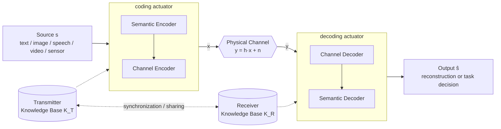

# Concepts

This document explains semantic communication (SemCom) and how `nexgenpy` fits a SemCom pipeline.

## What is SemCom?

SemCom is a communication paradigm. Its design objective is the correct delivery of the *meaning*, or of the *task-relevant content*, of a message. Its objective is not the bit-exact copy of the transmitted symbols.

Classical (Shannon) systems treat the link as a pipe that ignores content. They measure success with the bit error rate (BER) or the block error rate (BLER). SemCom changes the objective from **symbol fidelity** to **semantic fidelity**. In its goal-oriented form, the objective is **task success**.

### Weaver's three levels

The literature usually frames the field with Warren Weaver's extension of Shannon's theory (1949).

| Level | Problem | Question | Typical metric |
|---|---|---|---|
| **A: Technical** | Syntactic | How accurately can the symbols be transmitted? | BER, BLER, PSNR |
| **B: Semantic** | Meaning | How precisely do the symbols convey the intended meaning? | Sentence similarity, LPIPS, semantic distortion |
| **C: Effectiveness** | Pragmatic / goal | How effectively does the received meaning affect behaviour or achieve the goal? | Task accuracy, control cost, AoI/VoI |

Level B is SemCom in the narrow sense. Level C is **goal-oriented** (also called **task-oriented**) communication. Most current literature puts both levels under the SemCom name.

The field does not have an agreed definition or an agreed unit of semantic information yet.

### Why SemCom matters

- A system that sends only the semantically relevant information needs less bandwidth and power, and has lower latency.
- Learned joint source–channel coding (JSCC) schemes lose quality gradually at low signal-to-noise ratio (SNR). They do not fail abruptly.
- 6G is expected to carry machine-to-machine and agent-to-agent traffic. In that traffic, the receiver is a model that does a task, not a human who views raw data.

## The two objectives

`nexgenpy` and Nexgen Server support two objectives. Each application uses one of them for each link.

| Objective | The receiver… | Output `ŝ` | Example metric |
|---|---|---|---|
| **Semantic-level communication** | recovers the meaning, or recreates the source | A reconstruction | Sentence similarity, LPIPS |
| **Goal-oriented (task-oriented) communication** | does a task with the received representation | A task decision, for example a class label | Classification accuracy, detection mAP |

The [Quick start](example-pipeline.md) example is goal-oriented. The receiver outputs a label and does not recreate the sentence.

## The reference pipeline

The diagram shows the reference SemCom pipeline. The boxes show where Nexgen actuators can go.

| Symbol | Meaning |
|---|---|
| `s` | Source message (sentence, image, signal) |
| `z` | Semantic latent / feature vector |
| `x` | Channel input symbols |
| `y` | Channel output, `y = h·x + n` |
| `h` | Channel coefficient or matrix (channel state information, CSI) |
| `n` | Additive white Gaussian noise, `n ~ CN(0, σ²)` |
| `ŝ` | Reconstructed source or task output |
| `K_T`, `K_R` | Transmitter and receiver knowledge base |

`nexgenpy` does not model the physical channel. The application carries the output of the coding actuator to the receiver.

## Actuators in the pipeline

An actuator is a versioned, named Python function. Its type is `coding` or `decoding`.

- A **`coding`** actuator changes a source into a representation for transmission. It can be a semantic encoder, a channel encoder or a JSCC encoder.
- A **`decoding`** actuator changes a received representation into an output. The output is a reconstruction of the source or a task decision.

The actuator type does not say which SemCom block the actuator implements. The pipeline variant decides it:

| Variant | Coding actuator | Decoding actuator |
|---|---|---|
| **Separate semantic + channel coding** | Semantic encoder. A conventional channel code protects the features. | Semantic decoder |
| **Joint semantic–channel coding** | One network that contains the semantic encoder and the channel encoder (for example DeepSC or deep JSCC) | One network that contains the channel decoder and the semantic decoder |
| **Task-oriented (no reconstruction)** | Semantic encoder that keeps only the task-relevant features | Semantic decoder that outputs a decision directly |
| **Generative** | Encoder of compact cues (prompt, latent, sketch, tokens) | Generative model, conditioned on the received cues |
| **Split / edge inference** | Head of a deep neural network (DNN) on the device | Tail of the DNN on the edge server |

> [!WARNING]
> A generative decoding actuator can make content that looks correct but is wrong (hallucination). Perceptual metrics do not show this error. Also check semantic consistency, for example with CLIP score or semantic segmentation mIoU for images.

## Knowledge bases and versions

A knowledge base (KB) is the shared background knowledge that the transmitter and the receiver use to encode and interpret meaning. Examples are datasets, trained model weights, ontologies, knowledge graphs and codebooks.

If an actuator contains or downloads trained model weights, those weights are a part of the KB. A divergence between `K_T` and `K_R` is a **background knowledge mismatch**. It causes misinterpretation even when the physical link has no errors.

Nexgen versions help the two sides use the same actuator:

- For each actuator name, exactly one active version on the server is the latest.
- `load_actuator` always downloads the latest version.
- The server accepts a data item only from the latest version.

`nexgenpy` does not compare the transmitter version with the receiver version. A machine keeps its local copy until it calls `load_actuator` again. To keep the two sides in step, call `load_actuator` on each machine after each new version.

## Data and content items

| Item | What it stores | How `nexgenpy` makes it |
|---|---|---|
| **Data** | The output of an actuator (`metadata`), the `actuator_id`, an optional `linked_resource` and free-form `specs` | `run_actuator(..., dst=...)` sends `POST {dst}/data` |
| **Content** | An `identifier` and the original input of the actuator in `specs` | `run_actuator(..., dst=..., dst_save_original=True)` sends `POST {dst}/content` |

When `dst_save_original` is `True`, the library makes a random UUID. It uses the UUID as the content `identifier` and as the data `linked_resource`. Thus an application can find the original input of each output. For example, it can compare a reconstruction with its source, or train a model again.

## Standardization

As of October 2026, no 3GPP release specifies SemCom. 3GPP Release 20 is the 6G study phase, and Release 21 will carry the first normative 6G specifications. Nexgen does not follow a standard format for actuators, features or KBs.

## Glossary

### Project terms

| Term | Definition |
|---|---|
| **Actuator** | A versioned, named Python function that processes data. The server stores its source code. Clients download it and run it. |
| **Actuator type** | `coding` or `decoding`. The `atype` parameter of `@actuator` and the `actuator_type` field on the server. |
| **Coding actuator** | An actuator that changes a source into a representation for transmission. It can be a semantic encoder, a channel encoder or a JSCC encoder. |
| **Decoding actuator** | An actuator that changes a received representation into an output. The output is a reconstruction of the source or a task decision. |
| **Latest version** | The one active version of an actuator name that has `latest: true` on the server. `load_actuator` always downloads it. |
| **Card** | The `card.json` file in the local actuator directory. It stores the server `id`, the `version` and other metadata. |
| **Data item** | A record on the server that stores the output of an actuator (`metadata`), the `actuator_id`, a `linked_resource` and `specs`. |
| **Content item** | A record on the server that stores the original input of an actuator, with an `identifier` and `specs`. |
| **Linked resource** | The UUID that connects a data item to its content item. |
| **`dst`** | The root URL of the server that gets the data items and the content items. |
| **Actuators directory** | The local directory for downloaded actuators. The default is `nexgen_actuators`. |

### SemCom terms

| Term | Definition |
|---|---|
| **SemCom** | Semantic communication. A communication paradigm whose design objective is the correct delivery of the meaning, or of the task-relevant content, of a message. |
| **Semantic-level communication** | SemCom in which the receiver recovers the meaning or recreates the source. |
| **Goal-oriented / task-oriented communication** | SemCom in which the receiver must perform a task (classification, detection, control), not reconstruct the source. The transmitter transmits only task-relevant features. |
| **Semantic information** | The meaning that a message carries relative to a shared context or shared knowledge. It is different from Shannon's statistical (syntactic) information. |
| **Semantic encoder** | A module (usually a neural network) that extracts a compact representation of the meaning, or of the task-relevant features, of the source. |
| **Semantic decoder** | A module that interprets the received representation. It recovers the meaning, reconstructs the source, or outputs a task decision directly. |
| **Channel encoder / decoder** | A module that protects semantic features against channel impairments. In learned systems, it is often merged with the semantic encoder (see JSCC). |
| **Knowledge base (KB)** | Shared background knowledge that the transmitter and the receiver use to encode and interpret meaning. Examples: datasets, trained model weights, ontologies, knowledge graphs, codebooks. |
| **Background knowledge mismatch** | A divergence between the KB of the transmitter and the KB of the receiver. It causes misinterpretation even when the physical link has no errors. |
| **Semantic noise** | Any disturbance that changes meaning. Examples: ambiguity, KB mismatch, physical-channel errors that change semantics, adversarial perturbations. |
| **Semantic fidelity** | The degree to which the received meaning matches the transmitted meaning. |
| **JSCC** | Joint source–channel coding. Coding that designs compression and error protection together. It replaces the separate chain of source coding and channel coding. |
| **DJSCC** | Deep JSCC. JSCC in which the encoder and the decoder are neural networks, trained end-to-end through a differentiable channel model. |
| **SSCC** | Separate source–channel coding. The conventional design, for example JPEG/BPG/VVC + LDPC/Polar codes. It is optimal only asymptotically (infinite block length). |
| **Graceful degradation** | The quality decreases smoothly as the SNR decreases. This is a hallmark of DJSCC. |
| **Cliff effect** | In digital SSCC, the reconstruction quality collapses abruptly when the channel SNR drops below the design point. |
| **Generative SemCom (GenSC)** | SemCom in which the receiver regenerates content from compact semantic cues with a generative prior (VAE, GAN, diffusion model, LLM). |
| **Hallucination** | Generated content that looks correct but is wrong. A risk of generative receivers. |
| **Split / edge inference** | The encoder is the head of a DNN on a device. The decoder is the tail on the edge server. The semantic features are intermediate activations. |
| **IMT-2030** | The formal ITU designation for 6G. |

### Abbreviations

| Abbreviation | Meaning |
|---|---|
| AoI | Age of Information |
| BER | Bit error rate |
| BLER | Block error rate |
| CBR | Channel bandwidth ratio |
| CSI | Channel state information |
| DNN | Deep neural network |
| KB | Knowledge base |
| LLM | Large language model |
| SNR | Signal-to-noise ratio |
| UUID | Universally unique identifier |
| VoI | Value of Information |

## References

These sources give background on semantic communication (SemCom). Items marked *(preprint)* have no peer review yet.

### Foundations

- C. E. Shannon & W. Weaver, *The Mathematical Theory of Communication*, Univ. of Illinois Press, 1949.
- R. Carnap & Y. Bar-Hillel, *An Outline of a Theory of Semantic Information*, MIT RLE Tech. Rep. 247, 1952. [PDF](https://courses.cs.tau.ac.il/0368-4341/shared/Papers/CARNAP-HILLEL.pdf)
- J. Bao et al., *Towards a Theory of Semantic Communication*, IEEE NetSciCom, 2011. [PDF](https://apps.dtic.mil/sti/pdfs/ADA544137.pdf)

### Core systems

- E. Bourtsoulatze, D. B. Kurka, D. Gündüz, *Deep Joint Source-Channel Coding for Wireless Image Transmission*, IEEE TCCN, 5(3), 2019. doi:10.1109/TCCN.2019.2919300
- H. Xie, Z. Qin, G. Y. Li, B.-H. Juang, *Deep Learning Enabled Semantic Communication Systems*, IEEE TSP, 2021. [arXiv:2006.10685](https://arxiv.org/abs/2006.10685)
- J. Dai et al., *Nonlinear Transform Source-Channel Coding for Semantic Communications*, IEEE JSAC, 2022. [arXiv:2112.10961](https://arxiv.org/abs/2112.10961)
- K. Yang et al., *SwinJSCC: Taming Swin Transformer for Deep Joint Source-Channel Coding*. [arXiv:2308.09361](https://arxiv.org/abs/2308.09361) · [Code](https://github.com/semcomm/SwinJSCC)
- Y. Wang et al., *Transceiver Cooperative Learning-aided Semantic Communications Against Mismatched Background Knowledge Bases*. [arXiv:2301.03133](https://arxiv.org/abs/2301.03133)

### Surveys and tutorials

- T. M. Getu, G. Kaddoum, M. Bennis, *Semantic Communication: A Survey on Research Landscape, Challenges, and Future Directions*, Proc. IEEE, 112(11), 2024. doi:10.1109/JPROC.2024.3520707 · [IEEE Xplore](https://ieeexplore.ieee.org/document/10855638)
- T. M. Getu, G. Kaddoum, M. Bennis, *A Survey on Goal-Oriented Semantic Communication*, IEEE Access, 12, 2024. doi:10.1109/ACCESS.2024.3381967
- T. M. Getu, G. Kaddoum, M. Bennis, *Making Sense of Meaning: A Survey on Metrics for Semantic and Goal-Oriented Communication*, IEEE Access, 11, 2023. doi:10.1109/ACCESS.2023.3269848
- Z. Lu et al., *Semantics-Empowered Communication: A Tutorial-cum-Survey*. [arXiv:2212.08487](https://arxiv.org/abs/2212.08487)
- D. Gündüz et al., *Beyond Transmitting Bits: Context, Semantics, and Task-Oriented Communications*, IEEE JSAC, 2023. [arXiv:2207.09353](https://arxiv.org/abs/2207.09353)

### Goal-oriented communication

- *Towards Goal-Oriented Semantic Communications: New Metrics, Framework, and Open Challenges* (Goal-oriented Tensor). [arXiv:2304.00848](https://arxiv.org/abs/2304.00848)
- J. Luo, E. Delfani, M. Salimnejad, N. Pappas, *From Information Freshness to Semantics of Information and Goal-oriented Communications*, 2025 *(preprint)*. [arXiv:2512.12758](https://arxiv.org/abs/2512.12758)

### Generative and large-model SemCom

- Y. Zhou, Z. Zhu, F. Wang, S. Cui, *Generative Semantic Communication: Architectures, Technologies, and Applications*, Engineering, 2025. [arXiv:2412.08642](https://arxiv.org/abs/2412.08642)
- H.-L. Qin et al., *Generative AI Meets 6G and Beyond: Diffusion Models for Semantic Communications*, 2025 *(preprint)*. [arXiv:2511.08416](https://arxiv.org/abs/2511.08416)
- *Large-Language-Model Enabled Semantic Communication Systems* (LLM-SC). [arXiv:2407.14112](https://arxiv.org/abs/2407.14112)

### Standardization

- *An Introduction to Semantic Communication and Semantic-Aware Networking Standardization for 6G*, ACM. [Link](https://dl.acm.org/doi/10.1145/3701701.3701707)
- 3GPP Highlights Newsletter, Issue 12, June 2026. [PDF](https://www.3gpp.org/ftp/Information/Highlights/3GPP_Highlights_Issue_12_WEB.pdf)

### Security

See [Security](security.md#further-reading).

### Related project

- Nexgen Server: <https://github.com/iamalreadynoob/nexgen-server>
